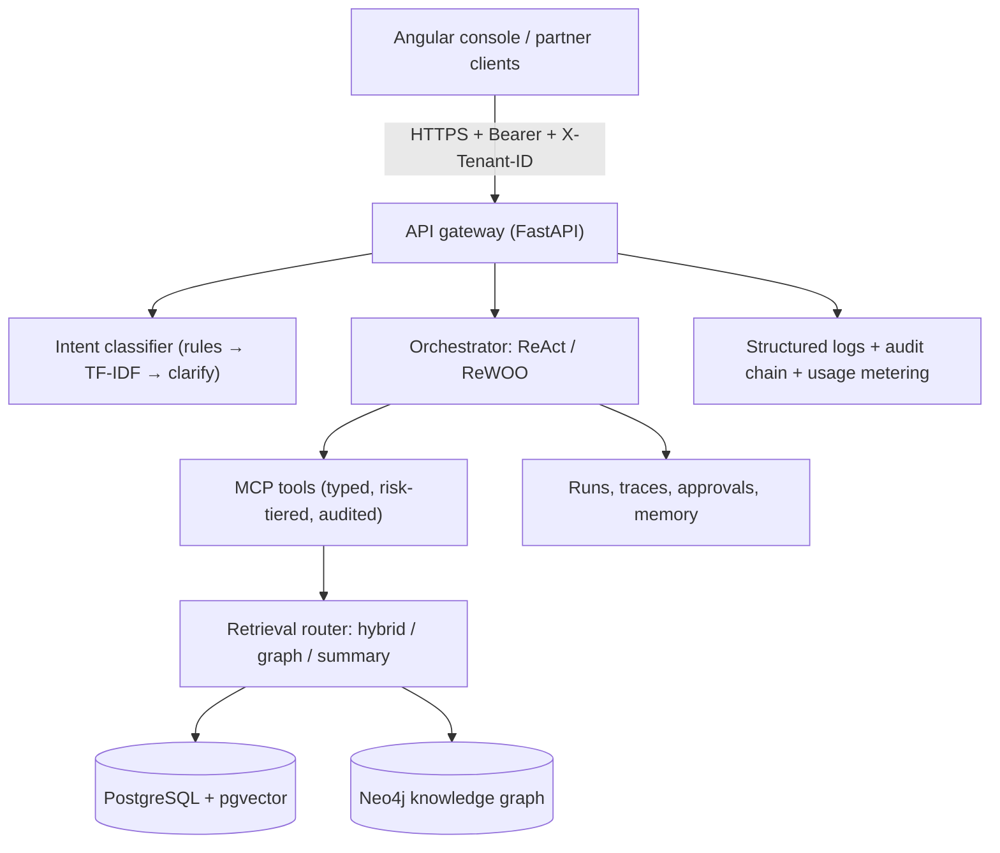

# Services AI Platform

A multi-tenant foundation for building, evaluating, deploying, and operating agentic AI workflows on AWS. Agents reach enterprise systems exclusively through governed API boundaries; retrieval combines lexical, vector, graph, and hierarchical strategies behind an observable router; every prompt, model, and agent version ships through evaluation gates with auditability, quotas, and cost attribution built in.

## Contents

- [Overview](#overview)
- [Architecture](#architecture)
- [Getting started](#getting-started)
- [Configuration reference](#configuration-reference)
- [Usage](#usage)
- [Testing](#testing)
- [Security and privacy](#security-and-privacy)
- [Deployment](#deployment)
- [Project structure](#project-structure)
- [Observability and operations](#observability-and-operations)
- [Troubleshooting](#troubleshooting)
- [Contributing](#contributing)
- [Roadmap and known limitations](#roadmap-and-known-limitations)
- [License](#license)

## Overview

Enterprise service work is document-heavy, rules-heavy, and scattered across systems. Ad hoc agent projects duplicate effort, open uncontrolled data paths, and stall at proof of concept. This platform is the shared engineering foundation that moves agentic use cases from approval to production in weeks: a modular orchestration runtime (ReAct today, ReWOO today, additional patterns behind the same interface), MCP servers as the only agent-to-system path, a hybrid retrieval stack (FTS + TF-IDF + RRF baseline, knowledge-graph retrieval, extractive summary trees), a versioned prompt registry with approval workflow, layered intent classification that clarifies instead of misrouting, and run history with full traces plus human-in-the-loop approvals.

Who it serves: platform engineers, agent developers, domain SMEs, ML practitioners, tenant admins, business sponsors, risk/audit, SRE, and partner UI/API teams. See `docs/PRODUCT_OVERVIEW.md` and the full requirement set in `docs/TRACEABILITY.md` (202 rows; the planning PRD itself stays local-only — see `docs/DECISIONS.md` ADR-006).

## Architecture



The backend is async Python (FastAPI) with Postgres as the system of record, Neo4j for extracted entity graphs, and a provider-agnostic model gateway (local deterministic backend for dev/tests; hosted backends arrive with model approvals). The Angular 19 console talks to the same versioned REST API (`openapi.yaml`, 29 paths) that partner teams use. Infrastructure is Terraform-managed AWS behind a compose-based local topology (API, web console, Postgres+pgvector, Neo4j).

Stack rationale: Python for the AI ecosystem, Angular per enterprise UI requirements, Postgres+pgvector for transactional-plus-vector consistency, Neo4j for thematic/graph retrieval, containers for reproducible environments. Each choice and its deferred alternative is recorded in `docs/DECISIONS.md`.

## Getting started

Prerequisites: Docker Desktop, Python 3.12, Node 20 (frontend only).

```sh
git clone https://github.com/MrKyaw/Agentic-Ops-Services-Platform && cd Agentic-Ops-Services-Platform
cp .env.example .env.local          # then set DEV_TOKEN, POSTGRES_PASSWORD, NEO4J_PASSWORD
python3 infra/scripts/preflight.py  # picks free ports, never kills anything; writes .env.local
DEV_TOKEN=<secret> docker compose --env-file .env.local up --build -d
```

Seed the pilot tenant once per fresh database:

```sh
docker exec Agentic-Ops-Services-phase1 python -c "
import os; from app.db import Store; from app.seed import seed
seed(Store(os.environ['DATABASE_URL']), 'tenant-local-01')"
```

Verify: `curl localhost:$API_PORT/healthz` → `{"status":"ok"}`. Console at `http://localhost:$FRONTEND_PORT` (sign in with the dev token + tenant). API reference at `/docs`. Full click-through in `docs/TESTING.md`.

Without containers (API only, needs Postgres + Neo4j reachable):

```sh
cd backend && pip install -r requirements.txt
DATABASE_URL=postgresql://postgres@127.0.0.1:5432/platform \
AUTH_MODE=dev DEV_TOKEN=<secret> DEV_TENANT=tenant-local-01 \
python3 -m uvicorn app.main:app --port 8000
```

## Configuration reference

| Variable | Purpose | Required | Example |
|---|---|---|---|
| `ENV` | local/dev/staging/prod; `prod` forbids dev auth | no (`local`) | `dev` |
| `AUTH_MODE` | `dev` static token or `oidc` JWKS | no (`dev`) | `oidc` |
| `DEV_TOKEN` | dev bearer token | yes unless OIDC | *(secret)* |
| `DEV_TENANT` / `DEV_ROLES` | dev identity binding | no | `tenant-local-01` / `tenant-admin` |
| `DATABASE_URL` | Postgres DSN | yes | `postgresql://postgres@db:5432/platform` |
| `NEO4J_URI` / `NEO4J_USER` / `NEO4J_PASSWORD` | graph store; empty URI disables graph features with a clear 503 | no | `bolt://graph:7687` |
| `POSTGRES_PASSWORD` / `NEO4J_PASSWORD` | compose service credentials (git-ignored `.env.local` only) | compose | *(secret)* |
| `OIDC_ISSUER` / `OIDC_AUDIENCE` / `JWKS_URL` | OIDC validation | OIDC mode | — |
| `API_PORT` / `FRONTEND_PORT` / `DB_PORT` / `NEO4J_*_PORT` | host ports; preflight shifts on conflict | no | `8000` |
| `CORS_ORIGINS` | allowed origins | no | `https://app.example` |

Fail-fast behavior: `prod`+`dev` auth refused at startup; OIDC without issuer/audience/JWKS refused; compose requires DB passwords. No secret belongs in the repo — see `SECURITY.md`.

## Usage

- **Classify:** `POST /v1/intents/classify {"text": "..."}` → workflow, confidence, `matched | clarified | no_match`. Ambiguous input clarifies; nothing silently misroutes.
- **Ask grounded questions:** `POST /v1/kb/query {"kb_id","query","strategy":"auto|hybrid|summary|graph"}` → answer with citations or an explicit abstention.
- **Run agents:** `POST /v1/runs/ {"agent_id","input":{"message"}}` (+ `Idempotency-Key`) → traced run; write actions pause at `waiting_approval` for the `/v1/approvals/` inbox.
- **Build knowledge:** `POST /v1/kb/ingest`, `/v1/graph/{kb}/build-graph`, `/v1/graph/{kb}/summaries`, `/v1/graph/{kb}/themes`.
- **Govern:** `/v1/usage/summary` (cost showback), `/v1/admin/quotas`, `/v1/admin/kill-switch`, `/v1/memory/{agent}` (inspect/erase).

## Testing

```sh
# backend (needs Postgres; Neo4j optional — graph tests skip without it)
TEST_DATABASE_URL=postgresql://postgres@127.0.0.1:5432/platform \
TEST_NEO4J_URI=bolt://127.0.0.1:7687 TEST_NEO4J_PASSWORD=<secret> \
AUTH_MODE=dev DEV_TOKEN=test-token-abc DEV_TENANT=tenant-test-01 \
python3 -m pytest backend/tests/ -q
python3 -m pytest evals/ -q                                   # classifier golden set
cd frontend && npx ng test --watch=false --browsers=ChromeHeadless
terraform -chdir=infra/terraform validate
```

Current state: 37 backend tests + 3 eval gates + 2 frontend specs green; ~90% backend line coverage; golden-set intent accuracy reported per run with production targets (F1 95%+, collision <0.5%) enforced at promotion, not on the seed set. What's not yet covered: load/soak, chaos, penetration testing, hosted-model evals — tracked in `docs/PROGRESS.md`, never silently omitted.

## Security and privacy

Fail-closed auth (dev token or OIDC JWKS with tenant-claim binding), mandatory tenant-header match, role matrix (`tenant-admin` vs `member`, tested), tenant-scoped queries on every store and graph access, tenant-bound idempotency, hash-chained redacted audit log, PII-redacted structured logs, RFC 7807 errors, risk-tiered tools with approval gates, kill switches at platform/tenant/agent scope. Threat model: `docs/THREAT_MODEL.md`; data flows: `docs/DATA_FLOW.md`; control mapping (not legal advice): `docs/COMPLIANCE.md`. Report vulnerabilities privately per `SECURITY.md`.

## Deployment

Not done — deliberately. Terraform validates but has never been applied; no cloud credentials have touched this project. Applying requires review-board approval, remote state, and a named environment, followed by a Gate 2 review (target, region, secrets plan, rollback, smoke tests, monitoring) before anything reaches any environment. The local compose topology (API + console + Postgres + Neo4j) is the dev loop, not a production posture: single replica, in-memory rate limiting, trust-auth loopback DBs.

## Project structure

```
backend/            FastAPI service (routers, runtime, retrieval, migrations, tests)
frontend/           Angular 19 console (login, runs+traces, approvals, agents, playground, usage)
evals/              golden datasets + harness measuring the real classifier
e2e/                reserved for containerized journey tests (pending)
infra/              Terraform landing-zone skeleton, preflight port script, CI
docs/               understanding, traceability (202 rows), architecture, decisions, runbook, evidence/
openapi.yaml        generated contract (regenerate from the app; drift fails CI)
```

## Observability and operations

`/healthz`, `/readyz`, per-request correlation IDs, JSON logs, hash-chained audit trail, per-run usage records with cost math, approval queue surfacing. Runbook: `docs/RUNBOOK.md` (local run, verify, incident notes for 401/403/429/503, rollback posture).

## Troubleshooting

- **Port busy at startup:** preflight shifts automatically (e.g. 8000→8001) and prints the map; compose must be run with `--env-file .env.local`.
- **API 500 on first run:** migrations run at container start — check `docker logs Agentic-Ops-Services-phase1` for the applied list.
- **Empty intents/KB:** seed the tenant (see Getting started); tests seed automatically.
- **Graph endpoints 503:** set `NEO4J_URI` (+ password); features degrade with an explicit error, never silently.
- **429 on runs:** tenant rpm quota hit — inspect/raise via `/v1/admin/quotas`.

## Contributing

Conventional commits, `ruff` clean, tests green before push, no secrets or real user data, traceability rows updated with behavior changes. The planning PRD stays local-only; commit `docs/PRODUCT_OVERVIEW.md` instead.

## Roadmap and known limitations

ReWOO is in; remaining: dense embeddings + reranker (blocked on model approvals), LLM adjudication tier, write-capable enterprise MCP servers, fine-tuning workflows, experiment tracking UI, streaming responses, multi-AZ/HA, backfills for erasure across summaries/graph, and the full non-functional battery (load, soak, chaos, pen test). Each limitation is labeled where it bites, not buried.

## License

MIT — see `LICENSE`.
