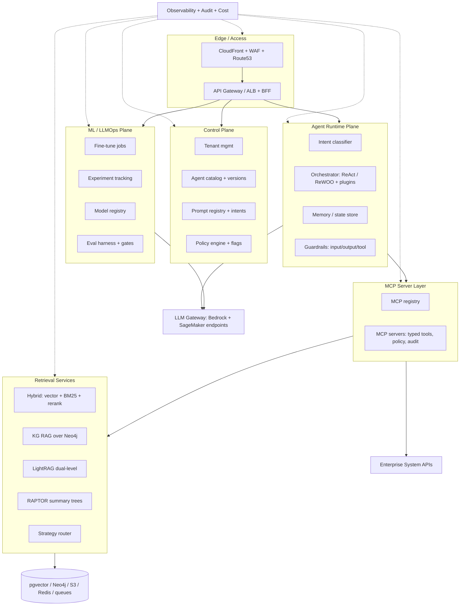

# ARCHITECTURE.md

## Diagram (logical, per PRD Section 8)

## Component responsibilities

- Edge/BFF: OIDC auth, tenant extraction, rate limits, quotas, WAF, RFC7807 errors, SSE streaming, Angular static hosting.
- Control plane: tenant lifecycle, RBAC/ABAC, agent/prompt/intent registries, policy, feature flags, approvals.
- Runtime: layered intent classification, ReAct + ReWOO execution, durable state, budgets, HITL checkpoints, structured-output validation, traces.
- MCP layer: the only agent-to-system path; typed schemas, identity propagation, risk tiers, idempotency, dry-run, audit, anti-poisoning (signed manifests).
- Retrieval: ingestion pipelines (parse/chunk/PII/ACL), hybrid + KG + LightRAG + RAPTOR behind a versioned strategy router; retrieval-time ACL; citations + grounding.
- Data: Aurora Postgres + pgvector (RLS, HNSW), Neo4j (scoped graphs), S3 (prefixed/versioned/encrypted), Redis (cache/rate/state), queues (SQS/EventBridge) + Step Functions/Temporal.
- ML plane: datasets, SageMaker jobs, registry, experiments, eval harness wired into CI/CD gates and canary analysis.
- Cross-cutting: OpenTelemetry traces, golden-signal metrics, PII-redacted logs, SLOs/alerts, per-tenant cost metering, immutable audit chain.

## Data flow (request path)

1. Console/partner → Gateway (auth, tenant, quota) → Intent classifier (rules → embedding → LLM adjudication) → exactly one workflow instance.
2. Orchestrator loads versioned manifest + prompts → plans (ReWOO) or loops (ReAct) → calls MCP tools and retrieval services only.
3. Retrieval assembles ACL-filtered, deduped context with citations → LLM gateway (policy-routed model + fallback) → schema/guardrail validation → HITL if risk tier demands → output + trace + usage records.

## Trust boundaries

- Public edge → authenticated tenant context (boundary 1).
- Runtime → MCP/API boundary: no credentials or routes to enterprise DBs from agent pods (network policy + static-analysis enforcement) (boundary 2).
- Retrieval → stores: platform services only, ACL enforced at query time (boundary 3).
- ML plane → training/serving: dataset policy checks + approval-gated promotion (boundary 4).
- All boundaries emit redacted structured audit events.

## Stack rationale

PRD-mandated and adopted without deviation: Python 3.11+ FastAPI (AI ecosystem fit), Angular LTS strict (enterprise UI consistency), Aurora pgvector (transactional + vector), Neo4j (graph/thematic retrieval), Bedrock + SageMaker via LLM gateway (portability, policy, cost), EKS/ECS + SQS/Step Functions (durable scale), Terraform/CDK + GitOps (repeatability). Build-vs-adopt seams (orchestrator SDK, store abstraction, tracker abstraction) keep options open for O3/O4.
