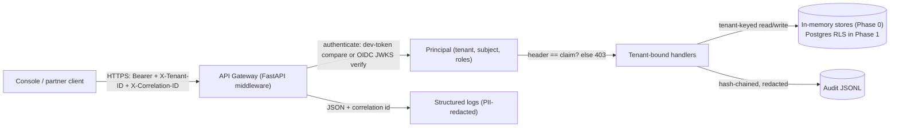

# DATA_FLOW.md (Phase 0)

## Personal data in Phase 0

Minimal: tenant ids, user subjects, role names, tenant display names. No document content,
no prompts, no embeddings. Audit and logs redact credential-shaped keys. All Phase 0
fixtures use synthetic values (`tenant-test-01`, `test-token-abc`).

## Future flows (not yet built)

Retrieval content, prompt/response capture, fine-tuning datasets — each gets a data-flow
update and privacy review in its own phase (PV-1..PV-6, DL-9).
